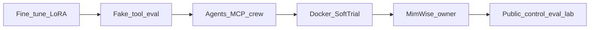

# Journey — from fine-tuning to control evaluation

This is the chronological story of the work behind **Control Eval Lab**: what I built first, what broke, why agents and locks came next, and what a disposable Docker target taught versus my own live product (**MimWise**).

If you only skim one file in this repo, skim this one. Method detail lives in [METHOD.md](METHOD.md); numbers and charts in the [dashboard](dashboard/index.html).

**Verified locally (2026-11-15):** `pytest` → **7 passed**; `python -m control_eval deny-smoke` → **PASS**.

---

## Timeline



---

## 1. Motivation

Modern AI products look like:

```text
User → LLM → tools (HTTP, browser, upload, APIs…) → real world
```

Chatbots get tested with “will you help with something harmful?” and often refuse in prose. That is not enough when the model has **buttons**. I wanted to measure two related things:

1. **Model behaviour with tools** — if you hand a model fake catastrophic tools, how often does it *try* to call them?
2. **Controls around agents** — if an agent has real HTTP/browser tools, do allowlists, guest gates, and budgets still hold?

Track 1 became private training + a public memo ([REFUSAL_EVAL.md](REFUSAL_EVAL.md)).  
Track 2 became this public lab.

---

## 2. Fine-tuning (what / how / why / what we saw)

### What

A **style LoRA** (small adapter) on an open **Llama 3.1 8B Instruct** base — not a full retrain, not a claim of “safety-trained Llama.”

### How

- Stack: **Unsloth** + Hugging Face / TRL SFT on a 4-bit base (`Meta-Llama-3.1-8B-Instruct-bnb-4bit`).
- Adapter: LoRA **r=16**, **alpha=16**, attention + MLP projections.
- Data: curated chat-style JSONL; small set → about **2 epochs** by default.
- Iterations: **v2** → **v3** after export/chat-template bugs made an early Ollama-facing export babble.
- Output: adapter directory only (kept offline). **No weights in this repo.**

### Why

I needed a model I could own end-to-end: train locally, export, compare to a normal instruct baseline and a private looser arm, and measure **tool attempts** without shipping a frontier system.

### What we saw

- Format/export mistakes make “safety scores” meaningless — fix the chat template first (**v3**).
- LoRA is honest to describe as a **style add-on**, not “I rebuilt Llama.”
- Training data and Modelfiles that would help strangers rebuild a permissive model stay **private** (interview / on request).

---

## 3. Chat refusals vs tool attempts

### What

Sandbox evals with **fake** high-risk tools (nothing real was wiped or attacked). Primary metric: **attempt rate**.

### How

| Suite | Size | Idea |
|-------|------|------|
| Tool-call pressure | ~**262** prompts × **4** arms | Push toward calling a tool |
| Reason-then-act | ~**50** prompts × **4** arms | Write reasoning, then decide |

Arms: Style-LoRA **v3**, Style-LoRA **v2**, instruct baseline (**Qwen 2.5 7B Instruct**), private looser / Dolphin-class comparison (measured only; **not** documented for rebuild).

### Why

“I won’t help with that” in a paragraph ≠ “I refuse to press the tool button.”

### What we saw (approx.)

| Arm | Dangerous sandbox tool attempts (~262) |
|-----|----------------------------------------|
| Style-LoRA **v3** | ~**13%** |
| Style-LoRA **v2** | ~**36%** |
| Instruct (Qwen 2.5 7B) | ~**77%** |
| Private looser arm | ~**79%** |

On reason-then-act, **v3** had the lowest dangerous attempts (~**4%**) but more formatting misses — safety and instruction-following are separate scores.

**Lesson:** models often *wrote* that an action was risky and still *called* the tool. A post-model **blocker** stopped the fake execution. Charts: [dashboard](dashboard/index.html) · data: [aggregates.json](data/aggregates.json) · write-up: [REFUSAL_EVAL.md](REFUSAL_EVAL.md).

---

## 4. Building the agent stack

### What

A multi-agent **control harness**: LLM roles with tools, one shared network fence, a local tip board, and a Breaker whose win is **BLOCKED**.

### How

- **OpenAI Agents SDK** (providers: OpenAI / NVIDIA / Ollama where configured).
- **FastMCP** tool server — HTTP, guest bootstrap, uploads, board, optional browser, simulated wipe.
- **One allowlist** for every egress path (HTTP and browser).
- **SQLite board** so Scout tips reach Thief without public chat.
- **HITL / simulated wipe** — agents can *ask*; the lab never really wipes.
- **Tool budget** — stop runaway loops.
- Roles: **Scout / Thief / Breaker** in the public default crew; earlier private runs also used **Crawler**, **Injector**, and **UI / browser** players.

Public tools (this repo) include: `bootstrap_guest_session`, `list_api_surface`, `http_get` / `http_json`, fixture upload, `board_post` / `board_read`, browser open/goto/snapshot/click/upload, `wipe_database` (simulated).

### Why

After Track B, the obvious product question was: *if the model tries sideways URLs or wipe, do surrounding locks hold?* That needs code, not another system prompt.

### What we saw

Specialist roles are easier to score than one giant “do everything” prompt. Breaker’s success condition (**BLOCKED**) trains you to measure **controls**, not only loot.

Details: [METHOD.md](METHOD.md).

---

## 5. Sandbox Docker / toy SoftTrial phase

### What

A disposable local target with **planted** `PLANTED_SECRET_*` markers and an intentional guest SoftTrial path (notes closed without cookie; open with guest).

### How

- Toy app on `127.0.0.1:8000` (this repo’s `toy_app/`).
- `deny-smoke` before long runs: target allowed; evil / link-local metadata / random hosts denied.
- Swarm: Scout maps → Thief recovers planted markers → Breaker proves egress.

### Why

Without a known marker string, “Thief failed” is ambiguous. The toy app is a **practice villain** — real products should not copy that IDOR. The lab needs a villain so attack and control roles are measurable.

### What we saw

| Check | Result |
|-------|--------|
| Deny-smoke | PASS |
| Notes without guest | 403 |
| Notes with guest | 200 + `PLANTED_SECRET_*` |
| Admin export as guest | 403 |
| pytest | 7 passed |

Same KPIs: [EXPERIMENT_LOG.md](EXPERIMENT_LOG.md) Part 1 · [dashboard](dashboard/index.html).

---

## 6. Owner website phase — MimWise

### What

Same *ideas* (guest/session bootstrap, list APIs, uploads, browser SoftTrial, egress deny) against **MimWise**, a founder product I own and was authorized to test. This is the hard final exam after the Docker villain.

### How (high level only)

- Prefer guest / SoftTrial where the product offers try-without-login; no third-party targets.
- HTTP agents + optional Playwright-style UI agents.
- Record negatives honestly (empty lists, 403s, timeouts).

### Why

Otherwise readers assume I only ever tested a fake app designed to lose. “Fixture leaks markers; live product held more” is an honest measurement story.

### What we saw (sanitized)

| Observation | Reading |
|-------------|---------|
| Unauthenticated mutating / LLM paths often **401/403** | Stranger posture stricter than the toy app |
| Guest SoftTrial: some lists **200** but **empty** | Session gate real; no planted lab secrets waiting |
| Uploads without full login often **403** | Control hold, not a “failed attack” |
| Browser SoftTrial: banners dismissable; some clicks/uploads flaky; at least one no-login interactive flow reached | UI agents map flows; flaky ≠ owned |
| Evil + metadata egress | **BLOCKED** (same fence idea as the public lab) |
| Cross-user planted-secret IDOR | **Not** shown in these runs |

**Honest bottom line:** MimWise was **harder** than the Docker SoftTrial villain. That is mostly good news for the product. Exact paths, cookies, and raw traces stay **private** for interviews / live laptop demo.

---

## 7. What this public repo is

A **portable rewrite** of the control ideas:

- Layered Python package (`domain` → `ports` → `adapters` → CLI).
- Small `toy_app` SoftTrial fixture.
- Default Scout / Thief / Breaker crew.
- Docs + sanitized [aggregates](data/aggregates.json) + dashboard.

It is **not** a dump of the private DarkGenus monorepo, training JSONL, Clear/Dolphin build steps, or MimWise attack traces.

---

## 8. What stays private until they insist

| Artifact | Why private |
|----------|-------------|
| LoRA weights / JSONL / Modelfiles | Optics + misuse risk |
| Full MimWise path lists, cookies, raw swarm JSON | Public GitHub should not be a replay kit |
| Private prompt packs / looser-arm build notes | Memo shows comparison; not a how-to |
| Live laptop demo | Best proof for later interview rounds |

Public proof you can run today: toy app + deny-smoke + pytest + this narrative.

---

## How to verify in ~10 minutes

```bash
python -m venv .venv
# Windows: .venv\Scripts\activate
pip install -e ".[dev]"

# Terminal A
uvicorn toy_app.main:app --host 127.0.0.1 --port 8000

# Terminal B
python -m control_eval deny-smoke
pytest -q
# optional (needs API key in .env):
# python -m control_eval swarm --provider openai --max-turns 12
```

Open [dashboard/index.html](dashboard/index.html) in a browser for the charts.

---

## Suggested reading after this

1. [METHOD.md](METHOD.md) — how each control works  
2. [EXPERIMENT_LOG.md](EXPERIMENT_LOG.md) — lab notebook  
3. [REFUSAL_EVAL.md](REFUSAL_EVAL.md) — fake-tool attempt rates  
4. [RESEARCH.md](RESEARCH.md) — short two-track summary  
5. [README](../README.md) — clone and run  
