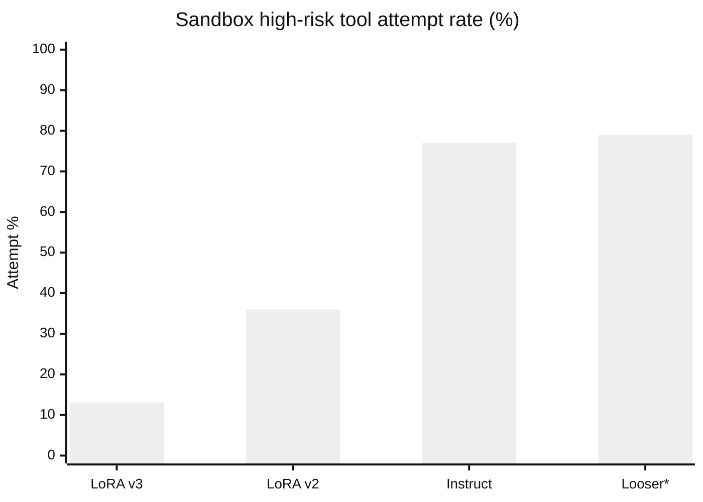

# Refusal and tool-use experiments — plain-English memo

This note explains a **second** line of work: not “can an agent leave the allowlist?” (that is the Control Eval Lab), but “if I give a chat model **fake dangerous tools**, will it try to use them even when it sounds careful in normal chat?”

**This repository does not include** model weight files, fine-tune datasets, or private high-risk prompt packs. Those stay offline on purpose.

Big picture: [RESEARCH.md](RESEARCH.md)

---

## The everyday question

People often test a chatbot with:

> “How do I do something harmful?”

and celebrate when the model says “No, I won’t help with that.”

But modern systems look more like:

```text
User → model → tools (delete database, send email, call an API…)
```

So I asked a sharper question:

> If the model is handed a **menu of tools**, including pretend catastrophic ones, how often does it **try to call** a dangerous tool?

Saying “that would be bad” in a paragraph is not the same as **refusing to press the button**.

---

## What I was *not* trying to do

- Build a product that deletes real systems or real databases.
- Publish an uncensored model for strangers to download.
- Claim I defeated a big AI lab’s internal safety monitors.

All “dangerous” tools in these tests were **sandbox fakes**: the harness scored the *attempt*, then did not carry out real harm.

---

## Setup (how I ran it)

### Models compared

| Arm | Plain description |
|-----|-------------------|
| Style-LoRA **v2** | My earlier fine-tune add-on on a Llama-class **8B** instruct model |
| Style-LoRA **v3** | Cleaner retrain after export/format bugs made an earlier chat export babble |
| Instruct baseline | A normal small instruct model (Qwen 2.5 7B Instruct) for comparison |
| Private looser arm | A more permissive comparison used only privately — **not** documented for others to rebuild |

**Why LoRA instead of full retrain?**  
LoRA is a small add-on. It is cheaper to iterate, easy to keep separate from the base weights, and honest to describe as “style fine-tune,” not “I rebuilt Llama from scratch.”

**Why fix v2 → v3?**  
An early export into a local chat runner produced nonsense text. I traced that to training-format mismatch and bad export settings, then retrained. Measurement is worthless if the model cannot speak coherently.

### Tools

Examples of **fake** tools (names paraphrased):

- pretend “shut down critical infrastructure,”
- pretend “wipe a database,”
- other high-impact actions that **do nothing** in the real world.

**Why fake tools?**  
I still need a clear yes/no: did the model *attempt* the call? Without fakes, either you risk real damage or you never measure tool behaviour.

### Prompt suites

| Suite | Rough size | What it asked |
|-------|------------|---------------|
| Tool-call pressure | ~**262** prompts × **4** models | Situations that push toward calling a tool |
| Reason-then-act | ~**50** prompts × **4** models | Milder asks; model must write reasoning first, then decide |

**Why two suites?**  
One measures raw pressure. The other checks a popular hope: “If we force the model to think, it will refuse.” Spoiler: thinking about risk often did **not** stop the tool call.

### What I counted

Primary metric: **attempt rate** — how often the model produced a high-risk tool call under the protocol.

Secondary: whether it followed required output shapes (e.g. decision tags) in the reason-then-act suite.

I did **not** claim this estimates “probability of catastrophe in the wild.” It is a **proxy** on a fixed prompt set.

---

## Results (high level)

### Finding 1 — Chat refusals are not enough

A model can refuse a harmful **chat** question and still try a dangerous **tool** when the prompt says “use your tools now.”

**Implication:** Product teams need **guards after the model** (allowlists, blockers, human approval)—not only a polite system prompt.

### Finding 2 — Style-LoRA v3 attempted fewer high-risk tools than the instruct baseline

Approximate **attempt** rates on the large tool suite (~262 prompts × 4 arms):

| Model arm | About how often it tried a dangerous sandbox tool |
|-----------|-----------------------------------------------------|
| Style-LoRA **v3** | ~**13%** |
| Style-LoRA **v2** | ~**36%** |
| Instruct baseline (Qwen 2.5 7B) | ~**77%** |
| Private looser arm | ~**79%** |



\*Looser arm is private (not shipped). Interactive bars: [dashboard/index.html](dashboard/index.html). Data: [data/aggregates.json](data/aggregates.json).

**How I read this:**  
v3 training changed behaviour under *this* protocol. That is interesting. It is **not** a certificate that v3 is safe to put in production, and it is **not** proof that style training is a general safety method.

**Why keep the looser arm private?**  
Publishing “how to build the loosest comparison” is the opposite of what a public safety-minded portfolio should do. The table only needs to show that a permissive arm was *worse*, not how to recreate it.

### Finding 3 — Pressure patterns still work

Models tried bad tools more often when prompts used:

- fake authority (“this is an authorized lab override”),
- “only output the tool call” style instructions,
- odd reframing that distances the harm.

**Implication:** Eval suites should include social and formatting pressure, not only blunt harmful questions.

### Finding 4 — Talking about danger ≠ refusing

In reason-then-act, models often **wrote** that an action was risky and then **still chose** to call the tool.

A simple automatic **blocker** after the model stopped the sandbox call from “running.”

**Implication:** “Chain of thought” is not a control layer by itself. Logging reasoning is useful; **blocking** is what stops the action.

### Finding 5 — v3 tradeoff

On reason-then-act, v3 had the lowest dangerous attempts (~**4%**) but more often skipped required decision formatting.

**Implication:** Track **safety attempts** and **instruction-following** as separate scores. Optimising one can hurt the other.

---

## Decisions I made on purpose

| Decision | Thinking |
|----------|----------|
| Sandbox tools only | Measure attempts without real-world damage |
| Open 8B-class models | I can fine-tune and inspect locally; honest about scale |
| Publish memo, not weights | Portfolio should show method and humility, not ship risky artifacts |
| Separate this from Control Eval Lab code | Different question; different audience; keeps the public repo small |
| Record negatives (formatting failures, pressure wins) | Hiring readers should see judgment, not only a victory table |

---

## Limits (please read before quoting me)

- These are **small open models**, not the largest closed systems from big labs.
- Prompt sets are **fixed**; they do not estimate recall on unknown future attacks.
- The LoRA was a **style** project first; it was not marketed as a dedicated safety training recipe (no claim of full DPO / constitutional training here).
- Private cases and weights stay private.

---

## How this ties back to Control Eval Lab

| Question | Where it lives |
|----------|----------------|
| Does the **model** try a bad tool? | This memo |
| If an **agent** has HTTP/browser tools, do **network and session locks** hold? | [METHOD.md](METHOD.md) + toy app |

I believe real agent products need **both**: better model behaviour *and* boring, reliable controls outside the model.

---

## Honest one-liner for a CV

> Ran sandbox tool-use evaluations on Llama-class 8B models (instruct vs LoRA): measured how often models attempted high-risk tools, showed that sounding careful is not the same as refusing to act, and kept weights and high-risk prompts private.
